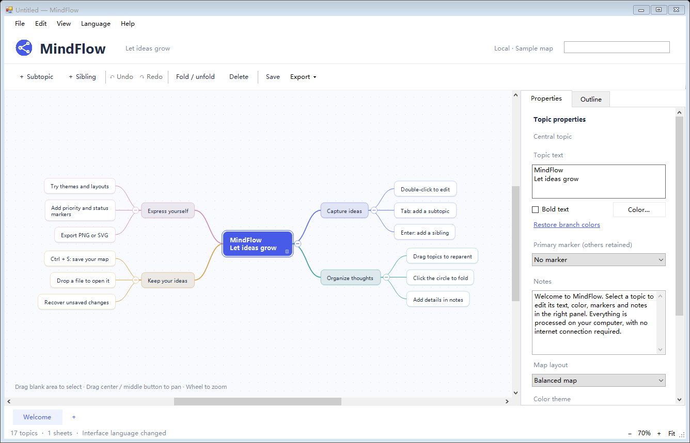

# MindFlow

**English** | [简体中文](README.zh-CN.md)

A lightweight Windows mind mapping application for organizing ideas, plans, and knowledge.

MindFlow focuses on quick editing and local storage. Create and edit maps offline, with your documents saved on your own computer.

## Features

- **Quick editing** — Add subtopics and sibling topics, reorder branches, fold and unfold topics, and undo or redo changes.
- **Flexible selection and navigation** — Drag a selection box, select multiple topics, zoom with the mouse wheel, and navigate with scrollbars or canvas panning.
- **Topic details** — Add notes, labels, links, colors, and markers. Apply supported formatting to multiple selected topics.
- **Multiple sheets and layouts** — Keep several sheets in one document and choose mind map, logic chart, organization chart, and other layouts. New maps and sheets default to a right-facing logic chart; existing files retain their layouts.
- **Local files** — Save in the native `.mf` format and drag files into the window to open them. Existing `.mindflow` files remain supported.
- **Open from Explorer** — Installation associates `.mf` files with MindFlow. Double-click a map to open it, including when MindFlow is already running.
- **Update notifications** — Check public GitHub releases in the background, at most once every 24 hours, or check manually from Help. Automatic checks can be disabled. Connection failures do not interrupt editing; download updates from the release page when you choose.
- **Import and export** — Import `.xmind` files and export XMind, PNG, SVG, and Markdown files.
- **Three interface languages** — Simplified Chinese, English, and Russian, with instant switching and a remembered preference. The built-in welcome map also follows the selected language; your own text is retained.
- **A focused workspace** — Properties and outline tabs share the right sidebar, leaving more room for the map.

Some imported layouts and visual effects are approximated. Complex fonts, icons, rich text, and styles may differ from the original. Full compatibility with every `.xmind` file and every visual detail is not guaranteed; keep your original files and native `.mf` documents.

## Screenshot

The English interface is shown above. Simplified Chinese and Russian are also available from the language menu.

## Download and installation

[**Download the latest release**](https://github.com/zscz668/MindFlow/releases/latest) · [All releases](https://github.com/zscz668/MindFlow/releases)

1. Open a release and download the Windows x64 installer from **Assets**. Version 0.2.2 uses `MindFlow-0.2.2-Setup-x64.exe`.
2. Run the English-language installer and follow the instructions. By default, it installs for the current user in `%LOCALAPPDATA%\Programs\MindFlow`, without administrator privileges.
3. Launch MindFlow. Use **语言 / Language / Язык** to choose the interface language.

The installation folder contains the application, configuration, and uninstaller. Usage instructions are available from the app's Help menu.

When updating, close MindFlow before installing the new version into the existing installation folder. Download the installer rather than GitHub's automatically generated “Source code” archives.

## System requirements

- Windows 10 or Windows 11.
- A 64-bit system.
- .NET Framework 4.x, normally included with Windows 10 and Windows 11.

An internet connection is not required for local map editing. Optional update checks only request public release metadata from GitHub; your maps are not uploaded.

## Feedback

Have a suggestion or found a problem? [Open an Issue](https://github.com/zscz668/MindFlow/issues).

If you have any questions or problems, please contact [zscz668@gmail.com](mailto:zscz668@gmail.com).

For bug reports, include your MindFlow version, Windows version, reproduction steps, and a screenshot if helpful. If you attach a map file, remove private information first.

## About

MindFlow is an independent Windows desktop application designed for personal use.

This repository provides downloads, documentation, and a place for feedback. The source code is not publicly available.
