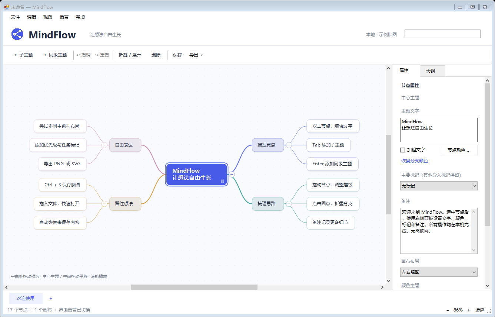

# MindFlow

[English](README.md) | **简体中文**

一款轻量、高效的 Windows 思维导图软件，帮助你整理想法、制定计划、梳理知识。

MindFlow 专注于快捷编辑和本地存储。无需联网即可创建、编辑脑图，文档保存在你自己的电脑上。

## 功能特点

- **快捷编辑**：添加子主题和同级主题、调整分支顺序、折叠与展开，以及撤销和重做。
- **灵活选择与导航**：拖动框选多个节点、滚轮缩放，通过滚动条或拖动画布调整视野。
- **丰富的主题信息**：添加备注、标签、链接、颜色和标记，支持对多个选中节点批量设置部分样式。
- **多画布与多布局**：一个文档可包含多个画布，支持脑图、逻辑图、组织图等布局。新建脑图和新增画布默认使用向右逻辑图，已有文件保留原布局。
- **本地文件**：使用原生 `.mf` 格式保存，拖入文件即可打开，继续支持旧 `.mindflow` 文件。
- **双击打开**：安装时关联 `.mf` 文件，双击即可打开，软件已运行时会交给现有窗口处理。
- **更新提醒**：后台检测 GitHub 正式版本，每 24 小时至多自动检查一次，也可通过帮助菜单手动检查或关闭自动检查；无法连接时不打断编辑，由你决定何时下载升级。
- **导入与导出**：导入 `.xmind` 文件，导出 XMind、PNG、SVG 和 Markdown 文件。
- **三种界面语言**：支持简体中文、英文和俄语，即时切换并记住上次选择；内置欢迎脑图也同步切换，自己编写的文字保留原样。
- **清晰的工作区**：属性与大纲位于右侧标签页，为画布留出更多空间。

部分导入布局和视觉效果采用近似显示，复杂字体、图标、富文本和样式可能与原文件不同。目前不保证所有 `.xmind` 文件及全部效果完全兼容，请保留原始文件和原生 `.mf` 文档。

## 软件截图

上图为简体中文界面，也可通过语言菜单切换到英文或俄语。

## 下载与安装

[**下载最新版本**](https://github.com/zscz668/MindFlow/releases/latest) · [全部版本](https://github.com/zscz668/MindFlow/releases)

1. 打开版本发布页，在 **Assets** 中下载 Windows x64 安装包。0.2.2 版本的文件名为 `MindFlow-0.2.2-Setup-x64.exe`。
2. 运行英文安装界面并按提示完成安装。默认安装到当前用户的 `%LOCALAPPDATA%\Programs\MindFlow`，无需管理员权限。
3. 启动 MindFlow，在 **语言 / Language / Язык** 菜单中选择界面语言。

安装目录仅放置主程序、配置和卸载器；使用说明可通过软件内的帮助菜单查看。

升级前请关闭 MindFlow，再将新版安装到原安装目录。请下载安装包，无需下载 GitHub 自动生成的“Source code”压缩包。

## 系统要求

- Windows 10 或 Windows 11。
- 64 位系统。
- .NET Framework 4.x，通常已随 Windows 10 和 Windows 11 提供。

本地脑图编辑无需联网。可选的更新检查只向 GitHub 请求公开版本信息，不上传脑图内容。

## 反馈建议

如果你有建议或遇到问题，欢迎[提交 Issue](https://github.com/zscz668/MindFlow/issues)。

如有问题，请联系 [zscz668@gmail.com](mailto:zscz668@gmail.com)。

反馈问题时，请提供 MindFlow 版本、Windows 版本、复现步骤，以及有助于说明问题的截图。附带脑图文件前，请先移除其中的私人信息。

## 关于

MindFlow 是一款面向个人使用的独立 Windows 桌面应用。

本仓库用于提供软件下载、使用说明和问题反馈。当前源码不公开。
